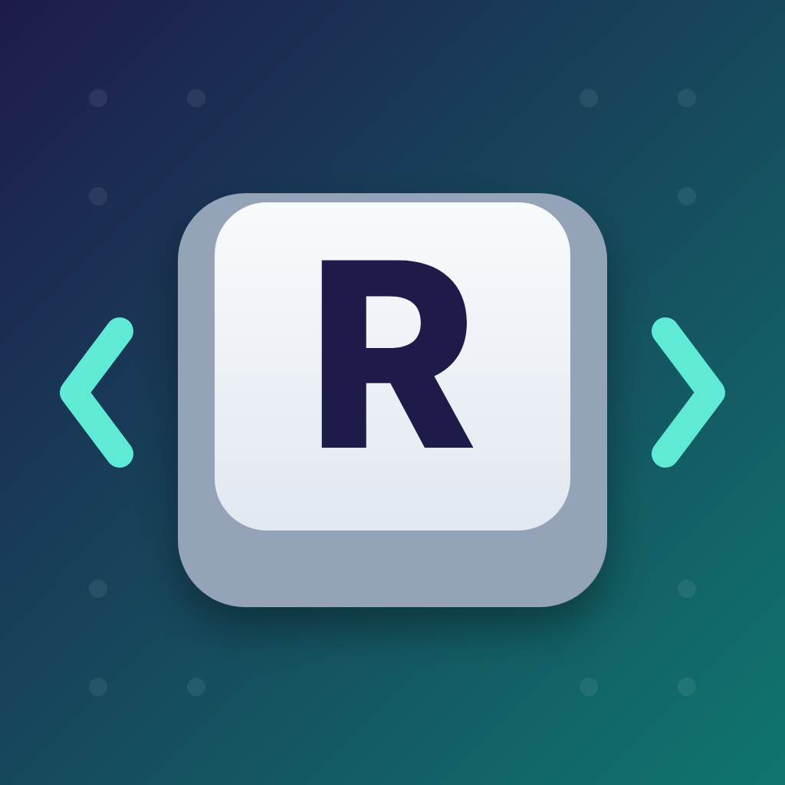

# GP2040 Remap

An easy, picture-based button remapper for controllers running
[GP2040-CE](https://github.com/OpenStickCommunity/GP2040-CE) firmware, in the
style of the remap tools that come with commercial boards. Built for people who
don't want to deal with GPIO numbers.



## Features

- **Click and press:** click a button on the picture, then press the real button on your controller.
  If that button already had a job, the two swap.
- **Auto-detect:** press any button to see its GPIO pin and what it does, and change it right there.
- **Two buttons, one job:** give two GPIO pins the same function (for example two Up buttons);
  each shows on the picture with its own GPIO.
- **Your controller's shape:** leverless and fightstick pictures you can rearrange, resize, and add
  buttons to, including A3/A4, Extra 1–12, dual directions, SOCD/D-pad mode switches and macros.
- **Console names:** show buttons as Xbox, PlayStation, Switch, Arcade or GP2040 names.
- **Guided setup** and a **button tester**.
- **My pads:** save several controllers in a gallery, and share them with friends as `.gp2040pad` files.
- **Automatic backup** of your old layout before the first save.

## Download

Get the latest `GP2040-Remap-…-Windows.zip` from
[Releases](../../releases). Unzip it and open `GP2040 Remap.exe`.
`GP2040 Remap (demo).exe` lets you try it without a controller.

Windows 10 or 11. The window opens using Microsoft Edge (built into Windows) in app mode.

## How to use

1. Unplug your controller.
2. Hold **Start (S2)** and plug it in. It starts in GP2040-CE's setup mode.
3. Open GP2040 Remap. It connects by itself (to `http://192.168.7.1`).
4. Click a button on the picture, then press the button you want it to be.
5. Press **Save to controller**, then **Finish and use controller**.

The full guide is in [`docs/READ ME.txt`](docs/READ%20ME.txt), which also ships in the zip.

## How it works

The app is a small Go program that serves its interface locally (on `127.0.0.1`) and
forwards requests to the controller's own GP2040-CE web configuration API
(`getPinMappings`, `setPinMappings`, `getHeldPins`, …). It only changes the main pin
mapping (profile 1) and never touches pins used by add-ons.

## Building

Requires Go 1.24+.

```sh
# Try it on any OS with a pretend controller (opens in your browser)
go run . -demo -browser

# Windows build with icon and version details
go install github.com/tc-hib/go-winres@v0.3.3
go-winres make --in winres/winres.json --arch amd64 --out rsrc
GOOS=windows GOARCH=amd64 go build -trimpath -ldflags "-H windowsgui" -o "GP2040 Remap.exe" .
```

Official builds are made by [GitHub Actions](.github/workflows/build.yml) from this repository.
Pushing a tag like `v1.0.0` builds, signs and publishes a release.

## Code signing policy

Free code signing provided by [SignPath.io](https://about.signpath.io),
certificate by [SignPath Foundation](https://signpath.org).

- Committers and reviewers: [Ricardilicious](https://github.com/Ricardilicious)
- Approvers: [Ricardilicious](https://github.com/Ricardilicious)

Only binaries built by this repository's GitHub Actions workflow from its own source code are signed,
and every release is approved manually.

## Privacy

This program will not transfer any information to other networked systems unless
specifically requested by the user or the person installing or operating it.
It only talks to your controller over its USB network connection (`192.168.7.1`).
Settings, pads and backups stay on your PC (in your settings folder and
`Documents\GP2040 Remap backups` / `Documents\GP2040 Remap pads`).

## License

[MIT](LICENSE). GP2040 Remap is an independent project and isn't affiliated with the
GP2040-CE team.
